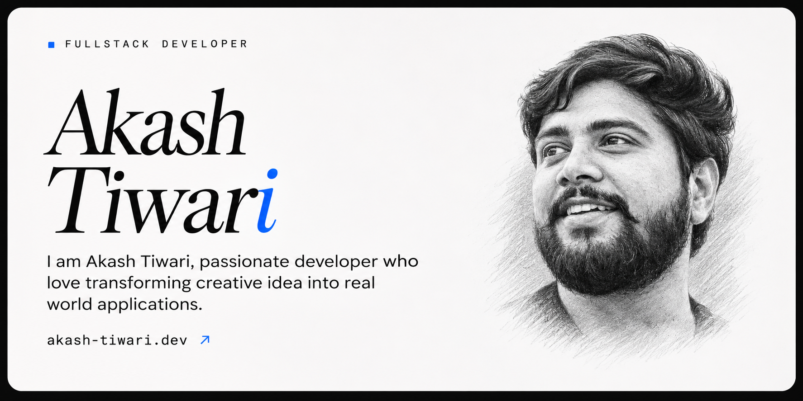

  

 
# Hey, I'm Akash Tiwari 👋

### 🚀 App Developer | Web Developer | Creative Builder

  Passionate about building modern mobile applications,
  beautiful websites, and meaningful digital experiences.

---

## 👨‍💻 About Me

I'm **Akash Tiwari**, a passionate developer who loves transforming creative ideas into real-world applications.

- 📱 Building Android and cross-platform applications
- 🌐 Exploring modern web development
- 🎨 Passionate about clean UI/UX and creative designs
- 🚀 Always learning and experimenting with new technologies
- 💡 Turning ideas into functional digital products
- 🎯 Focused on creating smooth and user-friendly experiences

---

## 🛠️ Tech Stack

### Languages & Technologies

### Development Tools

---

## 🚀 What I'm Building

I enjoy working on projects that combine technology,
creativity, and practical problem-solving.

### 📱 Mobile Applications

| Project | Description |
|---------|-------------|
| 🎵 **Vc_Player** | A music player application focused on a smooth listening experience. |
| 🎧 **Echo-Music** | A music application project with a focus on user experience. |
| 🌊 **LastWave** | One of my application development projects. |
| 🍎 **LastWave iOS** | The iOS project in the LastWave collection. |

### 🌐 Web Development

#### 🏡 Dream House

**Dream House** is a private web development project.

A modern website project focused on creating a clean,
professional, and user-friendly digital experience.

> 🔒 Private Project — Source code is not publicly available.

---

## 📊 GitHub Analytics

---

## 🔥 GitHub Streak

---

## 📈 Contribution Activity

---

## 🌐 Connect With Me

---

### 💻 Code. Create. Innovate.

*Building ideas into reality, one line of code at a time.*

⭐ Thanks for visiting my GitHub profile!

---

<!-- AUTO-UPDATE:START -->
## 🚀 My Public Projects

Automatically updated from my GitHub repositories.

| Project | Description |
|---------|-------------|
| [Echo-Music](https://github.com/1227akash/Echo-Music) | Explore this project on GitHub. |
| [antigem-standalone](https://github.com/1227akash/antigem-standalone) | Explore this project on GitHub. |
| [Horizon-Player](https://github.com/1227akash/Horizon-Player) | Cinema & Hi-Res Audio Media Player for Android • Liquid Glass OLED • 100% Private |
| [Craft-Anything](https://github.com/1227akash/Craft-Anything) | An open-source creative development toolkit. |

## 🛠️ Languages Used Across My Public Repositories

- **Kotlin** — 64.7%
- **Rust** — 29.8%
- **Go** — 2.0%
- **JavaScript** — 0.9%
- **GLSL** — 0.8%
- **C++** — 0.5%
- **Shell** — 0.4%
- **Java** — 0.4%
- **Python** — 0.3%
- **PowerShell** — 0.1%
- **CSS** — 0.0%
- **C** — 0.0%
- **Swift** — 0.0%
- **HTML** — 0.0%
- **CMake** — 0.0%
- **Handlebars** — 0.0%

📦 **Total Public Projects:** 4

<!-- AUTO-UPDATE:END -->
